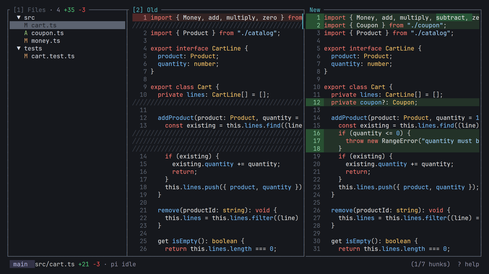
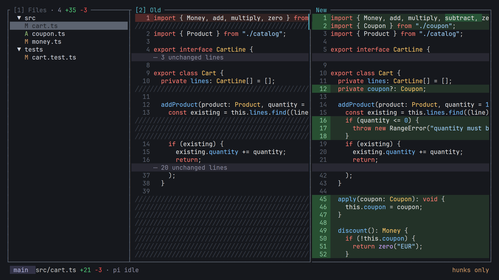
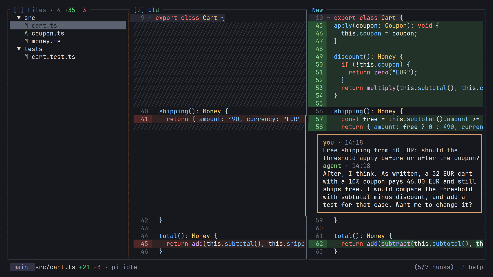
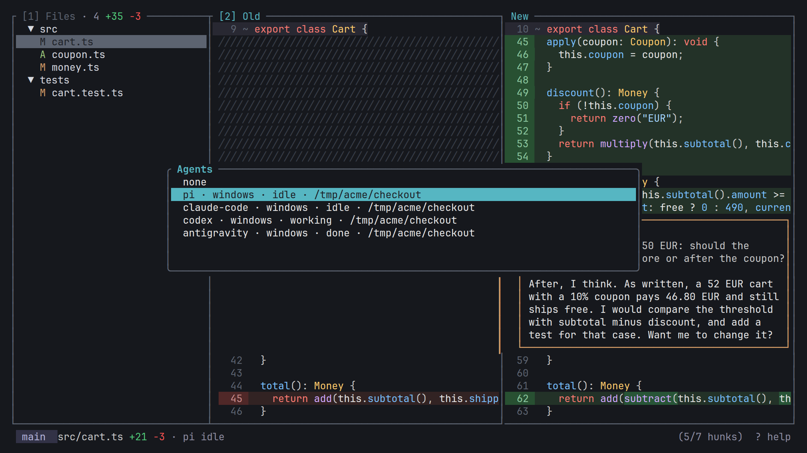

<p align="center"></p>

<h1 align="center">Lumiere</h1>

<p align="center">Review diffs in the terminal and discuss them with your coding agent.</p>

Lumiere is a side-by-side diff viewer for the terminal. You comment on the lines an
agent wrote; the agent answers inside the same thread while the review stays open.

- Side-by-side diffs with syntax highlighting, search, watch mode and stacked commits
- Hunks-only view, as on GitHub, or whole files
- Review threads on a selection, a hunk or a file, answered live by the agent
- One review across the repositories of a workspace folder
- GitHub pull requests with `--pr`
- Git and Jujutsu
- A `/lumiere` command for the [pi](https://github.com/earendil-works/pi) coding agent

<table>
  <tr>
    <td width="50%"><br /><sub>Side by side, with the whole file.</sub></td>
    <td width="50%"><br /><sub><code>z</code> folds the unchanged lines.</sub></td>
  </tr>
  <tr>
    <td><br /><sub>Comment on a hunk; the agent answers in the thread.</sub></td>
    <td><br /><sub><code>A</code> lists the agents running in the repository.</sub></td>
  </tr>
</table>

Lumiere is a fork of [Lumen](https://github.com/jnsahaj/lumen) by Sahaj Jain. See
[Relation to Lumen](#relation-to-lumen).

## Install

Lumiere needs Rust 1.89 or later.

```bash
cargo install --git https://github.com/aduverger/lumiere --locked
```

From a checkout, use `cargo install --path . --locked`. Both install the `lumiere`
binary in `~/.cargo/bin`.

## Quick start

```bash
lumiere diff                    # uncommitted changes
lumiere diff origin/main...-    # everything this branch adds, uncommitted changes included
lumiere diff HEAD~3..HEAD       # a range of commits
lumiere diff --pr 123           # a GitHub pull request (needs the gh CLI)
```

Press `i` on a line to comment, `Enter` to send the comment to the agent, and `?` for
every key.

## What to review

| Reference | Shows |
|---|---|
| none | Uncommitted changes |
| `SHA` | One commit |
| `A..B` | From `A` to `B` |
| `A...B` | From the merge base of `A` and `B` to `B` |
| `A..-` | From `A` to the working tree |
| `A...-` | From the merge base of `A` and the current commit to the working tree |

`A...-` is the form to use on a feature branch: it keeps showing only your changes
after `A` has moved on.

| Option | Effect |
|---|---|
| `--watch`, `-w` | Reload when files change |
| `--file PATH`, `-f` | Show only these files |
| `--focus PATH` | Open on this file |
| `--stacked` | Show a range one commit at a time (`Ctrl+L` / `Ctrl+H`) |
| `--pr N`, `--detect-pr` | Show a pull request, or the one of the current branch |
| `--wrap` | Wrap long lines |
| `--view hunks\|full` | Show only the changes, or whole files (default `hunks`) |
| `--theme NAME`, `-t` | Colour theme |
| `--vcs git\|jj` | Force the version control system (before `diff`) |

`lumiere diff` works from any directory of a repository.

### Hunks only or full file

By default Lumiere shows each change with three unchanged lines around it. A row such
as `⋯ 63 unchanged lines` stands for what is hidden. `z` switches to the whole file and
back, keeping the focused hunk in place.

- Lines under a review thread stay visible, even far from a change.
- Search in the file (`/`) covers the lines shown. Search in every file (`Ctrl+F`)
  covers whole files, and switches to the full file when the match is hidden.
- Added and deleted files look the same in both views.

## Review threads

A comment starts a thread on a selection, a hunk or a file. Select lines with the
mouse, or focus a hunk with `[` and `]`; with neither, the comment is on the file.
A hunk comment goes on the hunk's new lines, or on its old lines when only the old
panel is shown (`0`).

| Key | Effect |
|---|---|
| `i` | Comment, or reply when the lines already have an open thread. An unsent comment is edited instead. |
| `Enter` | Save the comment and send it to the agent now |
| `Option+Enter`, `Ctrl+S` | Save the comment as queued |
| `Shift+Enter`, `Ctrl+J` | New line |
| `s` | Send every queued comment as one message |
| `x` | Resolve or reopen the thread. Replying to a resolved thread reopens it. |
| `I` | List the threads. There, `x` resolves or reopens the selected one. |
| `A` | Choose the agent, or none |

- **Agent.** Lumiere looks for [Rex](https://rex.dev) panes running a coding agent
  whose working directory is a reviewed repository, the folder Lumiere was started
  from, or a folder inside one of them. It attaches to the most recently active one;
  `--agent-block BLOCK` names the pane instead. The footer shows the agent and its
  state, or `no agent`.
- **Which agents.** An agent is recognised by the
  [status](https://www.superlogical.com/rex/docs/build/program-status) it reports to
  Rex: pi, Claude Code, Codex (0.163 or later) and Antigravity, and by name only,
  untested, OpenCode, Hermes and Grok. An agent that reports no status is not found.
  The agent may ask your permission before it runs `lumiere thread reply`.
- **Agent waiting for you.** While the agent is asking you something, such as a
  permission, nothing is sent and the comment stays queued: submitting would answer
  its question. Answer the agent, then press `s`.
- **Sending.** Lumiere pastes one message into the agent's prompt and submits it. The
  message holds each comment with its thread id, file, lines and code, and the command
  to reply with. A follow-up in a thread leaves the code out and says how to read the
  earlier comments. The agent is asked to reply in the thread first and to edit code
  only after you approve there.
- **Without an agent** `Enter` queues, and `s` exits and writes the queued comments to
  standard output.
- **Storage.** Threads are kept per repository, outside it, in
  `~/.local/state/lumiere/` on Linux. They are shared by every range reviewed in that
  repository and come back when Lumiere restarts.
- **Outdated.** When the diff changes, a thread follows its lines if their text is
  found unchanged at exactly one place on the same side of the file. Otherwise it is
  marked `outdated`.

The agent uses three commands, from the repository or the workspace folder:

```bash
lumiere thread list [--awaiting] [--json] [--repo PATH]
lumiere thread show <thread-id> [--json] [--repo PATH]
lumiere thread reply <thread-id> (--body TEXT | --stdin) [--repo PATH] [--author NAME]
```

`--awaiting` keeps the open threads whose last sent comment is yours. Queued comments
are hidden from all three commands, and a resolved thread cannot be replied to.

## Workspace reviews

Run `lumiere diff` from a folder that is not a repository but has repositories
directly inside it:

```bash
cd ~/code/my-workspace      # contains api/, web/, ...
lumiere diff origin/main...-
```

- Only immediate child directories count. Symlinks and plain folders are ignored.
- The first repository, by name, that has changes opens first. `R` lists them all.
- Each repository keeps its own threads, viewed files and position.
- A repository where the requested revision does not exist stays in the list; choosing
  it shows the error.
- `s` sends the queued comments of every repository opened.
- The thread list (`I`) and watch mode cover the repository on screen only.
- `--pr`, `--detect-pr` and `--stacked` need a single repository.

## pi command

`pi-extension/` adds `/lumiere` to pi. Link it once from a checkout, then run
`/reload` in pi:

```bash
ln -s "$(pwd)/pi-extension" ~/.pi/agent/extensions/lumiere
```

```
/lumiere                    review origin/main...- with watch mode on
/lumiere diff HEAD~3..-     any lumiere arguments
```

- **Inside Rex** the review opens in a pane beside pi, zoomed to fill the window, and
  attached to that pi session. Pi keeps running behind it. Unzoom the pane to see both.
- **Elsewhere** pi is suspended while Lumiere uses the terminal. Comment, then press
  `s` and `Enter`: the comments are sent to the agent. `q` sends nothing.

`e` opens the file in pi's `EDITOR`, or in `vim` when it is not set. The value may
carry arguments, as in `code --wait`. `LUMIERE_BIN` selects the binary when `lumiere`
is not on `PATH`. The extension and the binary must come from the same version.

## Keys

`?` shows the full list:

| Key | Effect |
|---|---|
| `j` / `k`, arrows | Scroll, or move in a list |
| `Option+Up` / `Option+Down`, `Option+J` / `Option+K` | Previous / next file |
| `[` / `]` | Previous / next hunk |
| `Ctrl+P` | File picker |
| `/`, `Ctrl+F` | Search in the file, or in every file |
| `Tab` | Show or hide the sidebar |
| `Space` | Mark the file as viewed and go to the next |
| `0` / `-` / `=` | Old side only, new side only, both |
| `w` | Watch mode on or off |
| `z` | Hunks only, or the full file |
| `e` | Open the file in `EDITOR` |
| `y` | Copy the selection, or the file name |
| `R` | Switch repository in a workspace |
| `q` | Quit |

`Option` is `Alt` outside macOS.

## Settings

Lumiere reads `~/.config/lumiere/lumiere.config.json`, or the file given with
`--config` before `diff`:

```json
{
  "theme": "catppuccin-mocha",
  "wrap": true,
  "view": "full"
}
```

`view` is `"hunks"` (the default) or `"full"`; `--view` overrides it.

The theme comes from `--theme`, then the settings file, then `LUMIERE_THEME`, then the
terminal's background.

| Theme | Value |
|---|---|
| Default | `dark`, `light` |
| Catppuccin | `catppuccin-mocha`, `catppuccin-latte` |
| Dracula | `dracula` |
| Nord | `nord` |
| One Dark | `one-dark` |
| Gruvbox | `gruvbox-dark`, `gruvbox-light` |
| Solarized | `solarized-dark`, `solarized-light` |
| Flexoki | `flexoki-dark`, `flexoki-light` |

## Relation to Lumen

Lumiere started as a fork of [Lumen](https://github.com/jnsahaj/lumen) v2.32.0 and
keeps its diff viewer. It is developed on its own, does not follow Lumen's
releases, and restarts its version at 0.1.0. The main differences:

- Review threads with an agent replace Lumen's one-way annotations.
- Workspace reviews, the `A...-` reference and the pi command are new.
- Lumen's AI commands (`draft`, `explain`, `operate`, `list`, `configure`) are removed.
- The default view shows hunks only; Lumen always shows whole files.
- The binary, the settings file and the environment variable are named `lumiere`.
  Lumen's `lumen.config.json` and `LUMEN_THEME` are not read.

## Development

```bash
cargo build
cargo test
cargo clippy --all-targets
```

## License

MIT. Copyright Sahaj Jain (Lumen) and Alexandre Duverger. See [LICENSE](LICENSE).
