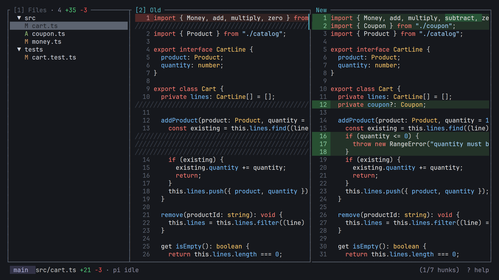
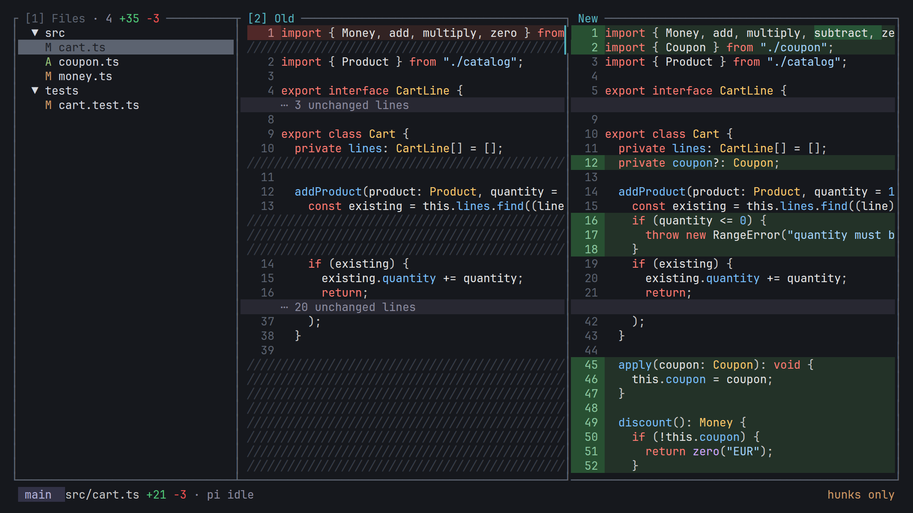
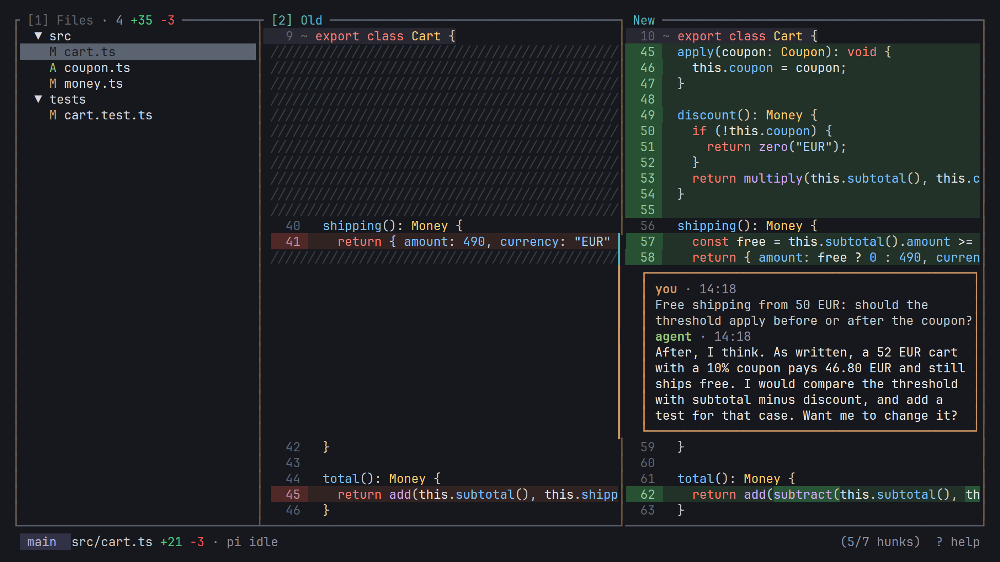
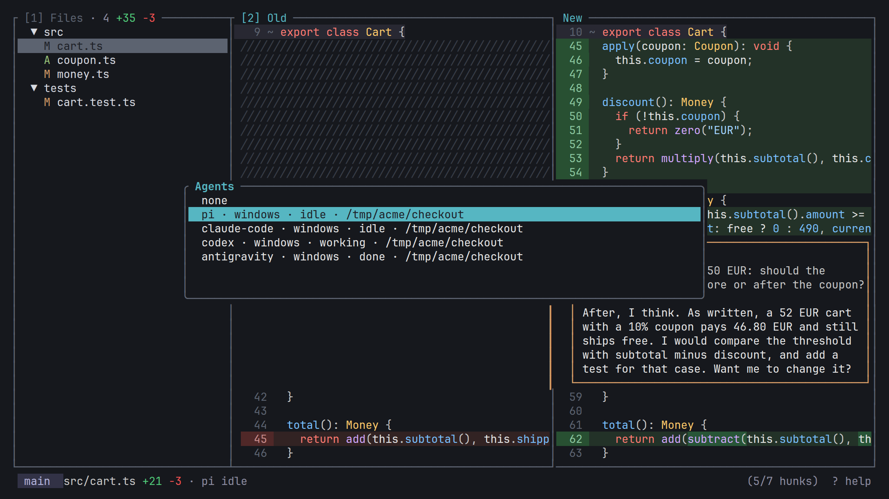

  
  <h1>Lumiere</h1>
  
Review diffs in the terminal and discuss them live with your coding agent.

**Lumiere** is a high-performance, side-by-side terminal diff viewer written in Rust. It is built for the modern code-review loop with coding agents: inspect uncommitted changes, feature branches, commit ranges, or GitHub pull requests, leave inline threaded comments directly on hunks or line selections, and converse with your agent inside the same thread without ever leaving the review.

  <figure class="screenshot-card">
    
    <figcaption>Side-by-side diff with Tree-sitter syntax highlighting and word-level emphasis.</figcaption>
  </figure>
  <figure class="screenshot-card">
    
    <figcaption>Hunks-only view by default — press <kbd>z</kbd> to unfold or refold unchanged lines.</figcaption>
  </figure>
  <figure class="screenshot-card">
    
    <figcaption>Threaded discussions anchored to lines, hunks, or files with live Markdown rendering.</figcaption>
  </figure>
  <figure class="screenshot-card">
    
    <figcaption>Press <kbd>A</kbd> to discover and attach to coding agents running in the repository.</figcaption>
  </figure>

## What makes Lumiere different

- **Built around review threads, not one-way notes.** Start a thread on a mouse selection, a focused hunk, or an entire file. Send comments immediately (<kbd>Enter</kbd>) or queue a batch (<kbd>Alt+Enter</kbd> / <kbd>Ctrl+S</kbd>) and dispatch them together (<kbd>s</kbd>). Your agent replies via `lumiere thread reply`, and its response appears live inside the open TUI.
- **Hunks-only by default, full file one key away.** Just like GitHub PR reviews, Lumiere opens focused on changes with three context lines around every hunk. Lines anchored by review threads remain visible even when far from a diff hunk.
- **Multi-repository workspaces.** Run `lumiere diff` in a folder containing several repositories (such as `api/` and `web/`). Switch between them with <kbd>R</kbd> while preserving each repository's threads, viewed markers, and scroll position, and send queued feedback across all repositories in one message.
- **Git and Jujutsu native.** Backed directly by `libgit2` (vendored) and `jj-lib` — no shelling out to `git diff` on every keystroke.
- **Designed for speed and zero idle cost.** Lazy per-language Tree-sitter grammar compilation, cached diff metrics, non-blocking background Rex discovery, and event-driven redraws keep startup fast and idle watch CPU at ~0%.

## Where to go next

- New to Lumiere? Start with [Installation](getting-started/installation.md) and the [Quick Start](getting-started/quick-start.md).
- Want to connect your coding agent? Read [Review Threads](guide/review-threads.md) and [Coding Agents & Rex Integration](guide/coding-agents.md).
- Looking for flags, themes, or keys? Jump to the [CLI Reference](reference/cli.md), [Configuration & Themes](reference/configuration.md), or [Keybindings](reference/keybindings.md).
- Curious how it is built? Read [Architecture & Core Primitives](architecture/overview.md).

## Origin & License

Lumiere started as a fork of [Lumen](https://github.com/jnsahaj/lumen) v2.32.0 by Sahaj Jain and is now independently developed and architected around threaded agent reviews, workspace reviews, and high-performance TUI primitives. Licensed under the MIT License.
